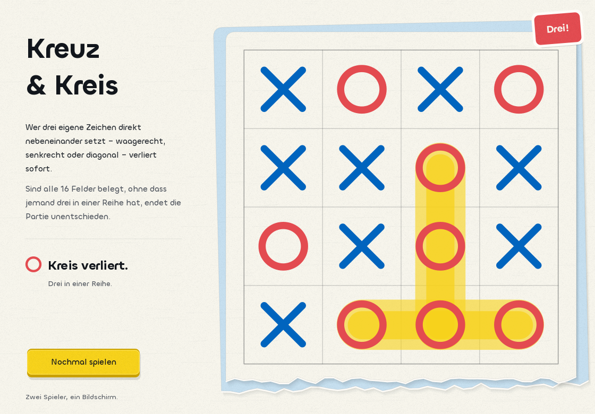

# Kreuz & Kreis

Ein 4×4-Spiel für zwei Spieler an einem Bildschirm. Wer drei eigene Zeichen
direkt nebeneinander setzt – waagerecht, senkrecht oder diagonal – verliert
sofort. Sind alle 16 Felder belegt, ohne dass jemand verliert, endet die Partie
unentschieden.



## Starten

Voraussetzung: **JDK 17 oder neuer**.

- `run.bat` – baut das Projekt und startet das Spiel.
- `build.bat` – baut nur; danach startet `java -jar KreuzKreis.jar`.
- `test.bat` – führt die Modell- und Oberflächentests aus.
- `preview.bat` – schreibt die Vorschaubilder nach `docs/`.

Unter macOS oder Linux funktioniert der Build auch von Hand:

```bash
mkdir -p out
find src/main/java -name '*.java' > sources.txt
javac --release 17 -encoding UTF-8 -d out @sources.txt
cp -r src/main/resources/* out/
jar --create --file KreuzKreis.jar --main-class de.kreuzkreis.Main -C out .
java -jar KreuzKreis.jar
```

## Bedienung

- Freies Feld mit der Maus anklicken.
- Tastatur: `Tab` zum Spielfeld, Pfeiltasten bewegen, `Enter` oder `Leertaste`
  setzt das Zeichen. `Tab` führt weiter zum Knopf.
- `Neue Runde` startet jederzeit neu; nach einer entschiedenen Partie heißt der
  Knopf `Nochmal spielen`.
- Ein Klick auf ein belegtes Feld ändert nichts. Nach dem Ende sind keine Züge
  mehr möglich.

## Regeln

- **Kreuz** beginnt, danach setzen die Spieler abwechselnd.
- Es verliert, wer mit seinem Zug **drei eigene Zeichen in einer ununterbrochenen
  Dreierfolge** hat. Das gilt für alle Zeilen, alle Spalten und alle Diagonalen
  in beide Richtungen – auch für kürzere Diagonalen am Rand.
- Ein volles Feld ohne solche Dreierfolge ist **unentschieden**.
- Die Prüfung erfolgt nach jedem Zug sofort; der Zug, der die Dreierfolge
  schließt, beendet die Partie. Ein volles Feld, dessen letzter Zug eine
  Dreierfolge schließt, ist deshalb eine verlorene, keine unentschiedene Partie.

## Projekt

```
src/main/java/de/kreuzkreis/
  Game.java              Spielmodell und Regeln
  Main.java              Startpunkt
  ui/
    AppPanel.java        Gesamtseite
    BoardPanel.java      Spielfeld, Maus- und Tastaturbedienung
    SidePanel.java       Titel, Regel, Status, Neustart
    PaperButton.java     Karton-Knopf
    PaperShapes.java     Papierformen und Schatten
    PaperTexture.java    Papierkorn
    Palette.java         Farbtokens
    Fonts.java           Chillax laden
    AppIcon.java         Fenstersymbol
src/test/java/de/kreuzkreis/
  GameTest.java          Regeltests
  UiTest.java            Klick-, Tastatur- und Neustarttests
  Preview.java           Vorschauen ohne Fenster rendern
src/main/resources/fonts/
  Chillax-Medium.ttf
  Chillax-Semibold.ttf
docs/
  preview-*.png
```

## Gestaltung

Die Oberfläche folgt dem **Hum**-Material aus
[Hallmark](https://github.com/Nutlope/hallmark), einem Design-Skill für
Webseiten. Weil die Aufgabe Java verlangt, wurde das Material auf Swing
übertragen: Creme-Papier mit Körnung, blau-schwarze Schrift, Karton-Knöpfe mit
Unterkante, gerissene Papierkanten, ein hellblauer Papiermatte unter dem Brett,
ein Pear-Highlighter über der Verlustreihe und ein Sticker als Ergebnis.

Die Designentscheidungen und Farbtokens stehen in [DESIGN.md](DESIGN.md).

## Schrift

**Chillax** von Indian Type Foundry, bezogen über
[Fontshare](https://www.fontshare.com/fonts/chillax). Nutzung nach der
[Fontshare Free Font License](https://www.fontshare.com/licenses/itf-ffl).
